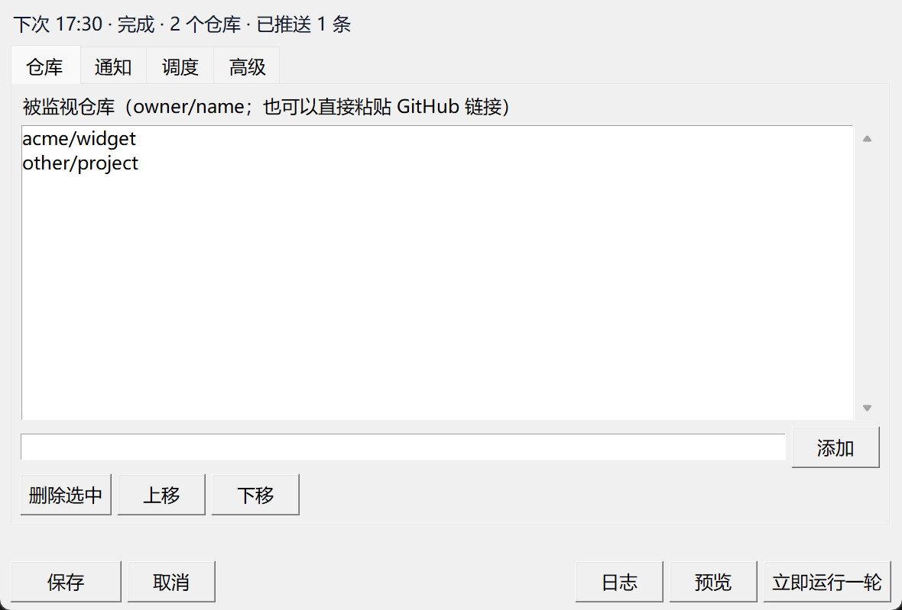

# refwatch

盯住一个 GitHub 仓库的**所有分支和 tag**，有变化就往 QQ 推一条摘要（提交清单 + compare 链接）。

两种形态，同一套引擎，都不经过 AI：

- **托盘应用**（Windows 默认）：常驻通知区域，配置在窗口里改，随时「立即跑一轮」或「预览」。
- **命令行**：`python watch.py`，只用标准库，交给计划任务或 cron。

推到 QQ 的东西长这样：

```
[acme/widget] 2 个 ref 有更新  (时间 UTC+0800)
* main  3 个新提交
  1. a1b2c3d 10-21 09:12 alice +42/-7
     fix(ui): 输入框在窄屏下换行
  2. b2c3d4e 10-21 11:03 bob +5/-5
     chore: bump deps
  3. c3d4e5f 10-22 08:40 carol merge
     Merge pull request #328 from dependabot/npm_and_yarn/vite-6
  compare: https://github.com/acme/widget/compare/9f8e7d6c5b4a..c3d4e5f6a7b8
  最新: https://github.com/acme/widget/commit/c3d4e5f6a7b8
* 新分支: feat/login  (c3d4e5f 登录页骨架)
```

配置它的时候长这样：



---

## 快速开始

### A. 托盘（推荐）

需要 **Git** 在 `PATH` 里；源码形态还需要 Python 3.9+ 和两个第三方包。

```powershell
git clone https://github.com/cup113/refwatch
cd refwatch
python -m pip install -r requirements-gui.txt
pythonw tray.py
```

或者直接下载 [最新发行版](https://github.com/cup113/refwatch/releases/latest)：`refwatch-setup-<version>.exe`
（每用户安装，不需要管理员），或免安装的 `refwatch-<version>-win64.zip`。
然后右键图标 →「打开设置…」→ 填仓库和凭据 → 保存，立刻生效。

### B. 命令行 / 无头（计划任务或 cron）

```powershell
powershell -ExecutionPolicy Bypass -File .\install.ps1
```

部署到 `%LOCALAPPDATA%\refwatch`、静默建一次基线、注册一个每 30 分钟跑一次的计划任务。
脚本幂等，**不会覆盖** `config.json` / `state.json` / 镜像仓 / 日志。
参数：`-Dest 'D:\gh-watch'`（换目录）、`-Minutes 60`、`-NoTask`（只部署不注册）。

> 托盘和计划任务是**二选一**：同时存在只会在 `.lock` 上互相跳过。托盘首次启动会问一次要不要移除旧任务。

两种形态都至少需要：`repos`（`["owner/name"]`）、接收方 `openid`，
以及机器人凭据 `QQBOT_APPID` / `QQBOT_SECRET`（写在数据目录的 `.env`，环境变量优先）。
`openid` 是接收方的 C2C id：让机器人收到对方一条消息后从事件体里读。
AppID/AppSecret 来自 [QQ 开放平台](https://q.qq.com/) 的机器人应用。

先试跑一次，不发送任何消息：

```powershell
python -X utf8 "$env:LOCALAPPDATA\refwatch\watch.py" --root "$env:LOCALAPPDATA\refwatch" --dry-run
```

---

## 它只看 ref 的 SHA，不看 diff

给每个 ref 记住上一轮的 SHA，再和这次的比。这样能分成四种情况，而 diff 分不出后两种：

| 事件 | 含义 | 怎么判定 |
|---|---|---|
| **update** | 分支上多了提交 | 旧 SHA 是新 SHA 的祖先 |
| **rewritten** | force-push / rebase / tag 被移动 | 旧 SHA 不是新 SHA 的祖先 |
| **new** | 新分支或新 tag | 这个 ref 在基线里没有 |
| **deleted** | 分支或 tag 没了 | 基线里有，`fetch --prune` 后不见 |

每个仓库**首次运行是静默的**：只记录基线，不会把几年历史一次性推给你。
`refs/pull/*` **永远不跟踪**（GitHub 给每个 PR 都广播 ref，热闹的仓库有几百个）。
原因与取舍见 [ADR-0001](docs/adr/0001-state-is-ref-to-sha.md)、[ADR-0002](docs/adr/0002-heads-and-tags-only.md)。

---

## 配置

`config.json` 在数据目录里（托盘形态是 `%LOCALAPPDATA%\refwatch`）。除 `repos` 外都可省略，
托盘里能改的都在设置面板里。

| 键 | 默认 | 含义 |
|---|---|---|
| `repos` | `[]` | 要监视的 `["owner/name", ...]` |
| `exclude_ref_patterns` | `dependabot/*`、`renovate/*` | 要跳过的 fnmatch 模式 |
| `max_commits_per_ref` | `15` | 每个分支最多列几条新提交 |
| `max_chunks_per_repo` | `2` | 每仓库每轮最多发几条 |
| `chunk_limit` | `4500` | 单条消息字数上限 |
| `openid` | `""` | 接收方；也可用环境变量 `QQBOT_OPENID` |
| `notify` | `true` | `false` = 只记录状态，从不发送 |
| `fetch_timeout_sec` | `300` | 单仓库 `git fetch` 超时 |
| `fail_alert_threshold` | `3` | 连续失败多少次后发一条告警 |
| `lock_stale_sec` | `1800` | 超过这个时长的锁视为残留 |
| `git_ssl_backend` | `"openssl"` | 仅 Windows；置空则不注入 `-c http.sslBackend=` |
| `interval_minutes` | `30` | 托盘的调度周期（`install.ps1 -Minutes` 也写它） |
| `autostart` | `true` | 登录时自启；托盘以它为准校正 `HKCU\...\Run` |
| `task_prompt_done` | `false` | 书签：旧计划任务已经问过了 |

---

## 托盘

右键图标：

| 菜单项 | 作用 |
|---|---|
| 状态 / 下次运行 | 只读 |
| 立即运行一轮 | 手动一轮：不动调度周期，也不挪动下一次的时间点 |
| 预览（不发送） | 和 `--dry-run` 同义：只显示将要发送的内容，**不发送、不推进基线** |
| 打开设置… | 设置面板（双击图标同效） |
| 打开日志 / 打开数据目录 | 开资源管理器 |
| 开机自启 | 开关；`autostart` 是真相，注册表是它的投影 |
| 暂停调度 | 只停自动调度，手动一轮仍可用；重启即恢复 |
| 退出 | 停调度、关图标 |

设置面板四页：[仓库](docs/screenshots/panel-repos.png) ·
[通知](docs/screenshots/panel-notify.png) · [调度](docs/screenshots/panel-schedule.png) ·
[高级](docs/screenshots/panel-advanced.png) · [日志抽屉](docs/screenshots/panel-log.png)

几个行为上的保证：

- **合并写**：面板不认识的键原样保留；文件被写坏了先备份成 `config.json.bak.<时间戳>` 再写；
  落盘是原子替换，并发的另一轮不会读到半个文件。
- **凭据只进 `.env`**，不进 `config.json`；面板会显示「当前凭据来源」。
- **单实例**：第二次启动会告诉你「已经在运行」，图标可能在任务栏 `^` 折叠区里。
- 崩溃可见：未捕获异常写 `logs/crash.log`（凭据已打码）并弹框，而不是「双击没反应」。
- 托盘自己的 `schtasks` 子进程也带 `CREATE_NO_WINDOW`，不会闪黑窗口（同 [ADR-0003](docs/adr/0003-windowless-scheduled-run.md)）。

打包（CI 在打 `v*` tag 时自动做）：

```powershell
python -m pip install -r requirements-gui.txt nuitka
python -m nuitka --standalone --enable-plugin=tk-inter --windows-console-mode=disable `
    --windows-icon-from-ico=assets/refwatch.ico --output-dir=build --output-filename=refwatch.exe tray.py
iscc /DAPP_VERSION=v1.0.0 installer.iss        # 需要 Inno Setup 6
build\tray.dist\refwatch.exe --one-round --dry-run --root <空目录>   # 冒烟：期望退出码 2
```

---

## 运维速查

| 想做的事 | 怎么做 |
|---|---|
| 改监视清单 | 托盘「打开设置…」，或编辑 `config.json` 的 `repos`（新仓库首次运行静默建基线） |
| 嫌吵 | 往 `exclude_ref_patterns` 加模式，例如 `refs/heads/codex/*` |
| 重建基线 | 删掉 `state.json` 里该仓库的条目，或整个删掉 `state.json`（面板故意不提供按钮） |
| 镜像仓坏了 | 删掉 `repos\<owner>__<name>.git`，下一轮自动重建；不想要积压就同时删掉它的状态条目 |
| 临时静音 | 托盘「暂停调度」，或把 `notify` 设成 `false` |
| 看发生了什么 | `logs/watch-YYYYMMDD.log`；异常看 `logs/crash.log`（托盘）或 `logs/error.log`（CLI） |
| 想回到计划任务 | 托盘退出，重跑 `install.ps1`。配置和基线都不动 |

退出码：`0` 正常，`1` 发不出去（凭据/token），`2` 配置有问题。

命令行参数：

```bash
python watch.py                        # 跑一轮
python watch.py --root D:\data         # 数据目录（state.json、repos/、logs/）
python watch.py --config other.json    # 另一个配置文件
python watch.py --repo owner/name      # 只检查这个仓库
python watch.py --dry-run              # 只打印，不发送、不推进基线
python watch.py --no-notify            # 推进状态但不发送
```

Linux / macOS 用 cron（那边不需要托盘，也没有黑窗口问题）：

```cron
*/30 * * * * cd /opt/refwatch && python3 watch.py --root /opt/refwatch >> logs/cron.log 2>&1
```

---

## 开发

```bash
python -m ruff check .
python -m unittest discover -s tests           # 零第三方依赖，CI 主体
python -m pip install -r requirements-gui.txt  # 只有要跑托盘/打包才需要
```

测试完全离线：在系统临时目录（可用 `REFWATCH_TEST_TMP` 改）里建丢弃式仓库当 `origin`。

- 在 ACL 受限的 Windows 沙箱里，`git` 的**本地传输**会 fork `sh.exe` 而失败 —— 在普通终端或 CI 跑。
- 托盘相关测试在没有 `pystray`/`PIL` 的环境里自动跳过；`test_icon` 与 `test_spawn` 的结构守卫
  只用标准库，任何环境都跑。

| 文件 | 作用 |
|---|---|
| `watch.py` | 引擎 + CLI：`run_round()` 是「一轮」的唯一实现 |
| `qq_notify.py` | QQ API + 凭据读取，可单独当命令行工具用 |
| `settings.py` | `config.json` / `.env` / 自启注册表的读写校验（无 GUI 依赖） |
| `scheduler.py` | 按 `interval_minutes` 触发一轮 |
| `panel.py` | tkinter 设置面板（上半部分是纯逻辑，可测） |
| `tray.py` | 托盘入口：单实例、菜单、线程桥接、`--one-round` 透传 |
| `install.ps1` / `installer.iss` | 无头部署 / 托盘安装包 |
| `tools/` | `window_probe.py`（窗口回归检查）、`make_icon.py`（图标生成，产物入库） |

加一种推送通道 = 替换 `watch.py` 里的一个函数 `deliver()`（[ADR-0004](docs/adr/0004-qq-only-with-notifier-seam.md)）。
托盘形态的来龙去脉：[ADR-0005](docs/adr/0005-tray-app-replaces-scheduled-task.md)、
[ADR-0006](docs/adr/0006-tray-stack-pystray-pillow-tk.md)、
[ADR-0007](docs/adr/0007-distribution-nuitka-standalone-inno.md)。

变更历史见 [CHANGELOG.md](CHANGELOG.md)。

---

## 刻意没做

- 超长摘要降级为**文件**上传：目前用「截断 + compare 链接」代替。
- 发送失败的**重试队列**：只记日志，下一轮重新攒。
- LLM 语义化摘要：那会把 AI 放回环内。
- 面板里的破坏性运维（重置基线 / 删镜像仓）：v1 只做配置与预览。
- 代码签名、自动更新、单文件 exe。

## 许可证

MIT —— 见 [LICENSE](LICENSE)。
